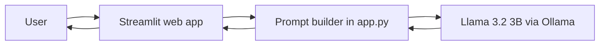

# 🛡️ LogSense

AI-powered security log explainer that runs 100% locally using an open-weight model.

## Problem
Security analysts and students read hundreds of raw log lines. Logs are cryptic, and beginners struggle to tell what is dangerous and what to do next.

## Solution
Paste a security log into the web app. LogSense returns a plain-language explanation: what happened, severity, possible attack type (MITRE ATT&CK), and next steps.

## AI Component
- **Model:** Llama 3.2 3B (open-weight, 3 billion parameters)
- **Runtime:** Ollama (runs locally, no cloud API, no API keys)
- **Role of AI:** The model reads the log and generates the explanation, severity rating, attack type and recommended actions. Without the model, the app has no function.

## Architecture


## Setup
1. Install Ollama from https://ollama.com
2. Download the model:
```bash
ollama pull llama3.2:3b
```
3. Install Python 3.10+ and dependencies:
```bash
pip install streamlit ollama
```
4. Run the app:
```bash
streamlit run app.py
```
5. Open http://localhost:8501

## Usage
Choose an example log from the sidebar (or paste your own) and click **Explain**.

## Testing and Findings
| Test | Input | Expected | Actual result | Status |
|---|---|---|---|---|
| SSH brute force | Failed password for root from 185.220.101.4 (x47 in 60 seconds) | High severity, Brute Force (T1110) | Explained the failed login correctly but rated severity as Low and gave a wrong ATT&CK ID | Partial |
| Suspicious PowerShell | powershell.exe -nop -w hidden -enc ... | High severity, Command and Scripting Interpreter (T1059) | TO BE FILLED | - |
| Port scan | 203.0.113.9 connected to 7 ports in 5 seconds | Medium severity, Network Service Discovery (T1046) | TO BE FILLED | - |
| Normal login | User logged in successfully from internal IP | Low severity, no threat | TO BE FILLED | - |

## Known Limitations
- The 3B model is small. It can underrate severity and give wrong MITRE technique IDs, as seen in the SSH test.
- Output should be reviewed by a human analyst. This tool assists analysts, it does not replace them.
- Single-log analysis only, no correlation across multiple logs.

## Team
- Ume Aiman (ayman-cyber13): idea, prompt design, interface, testing

## License
MIT License (see LICENSE file)

## Acknowledgements
- [Ollama](https://ollama.com)
- Llama 3.2 by Meta
- [Streamlit](https://streamlit.io)
- MITRE ATT&CK framework
